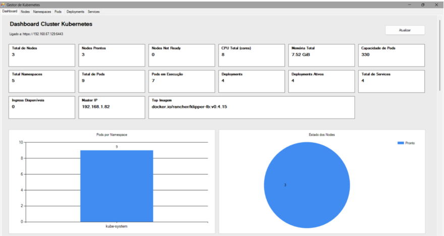
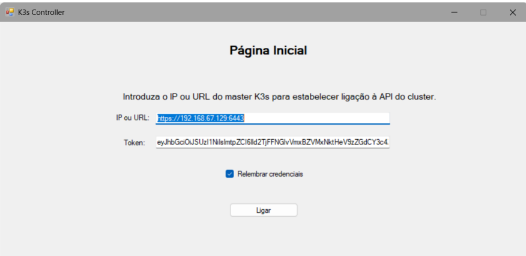
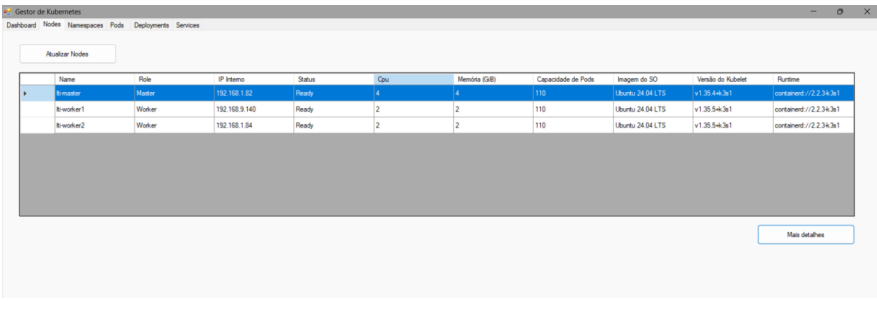
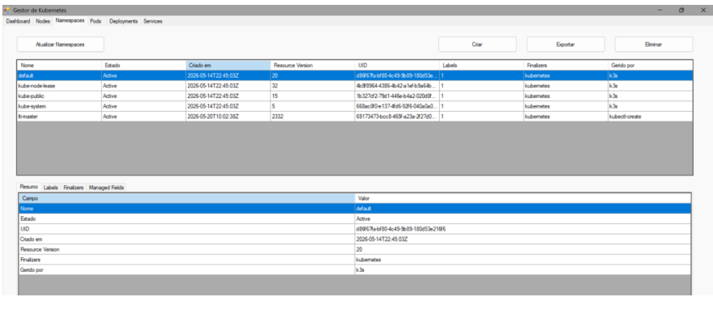
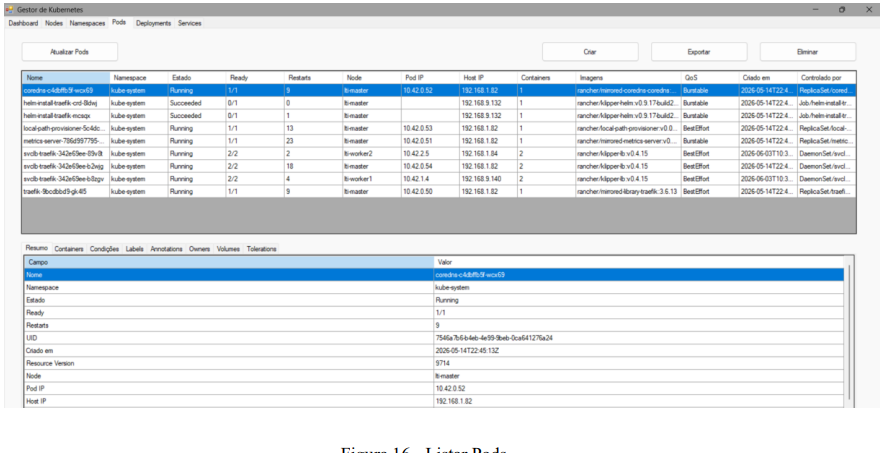
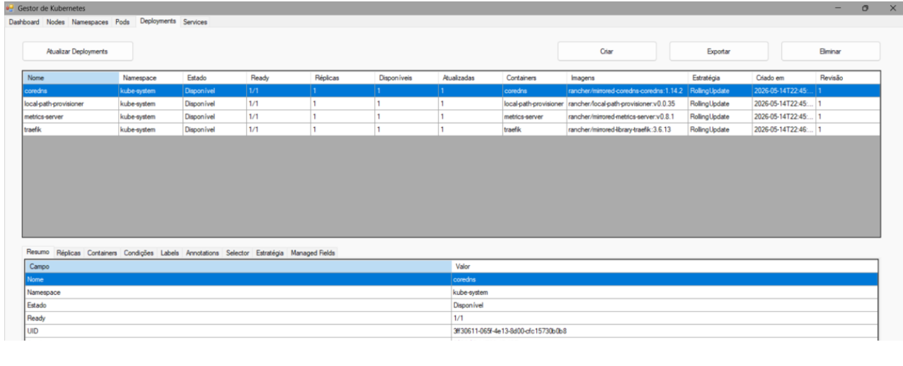
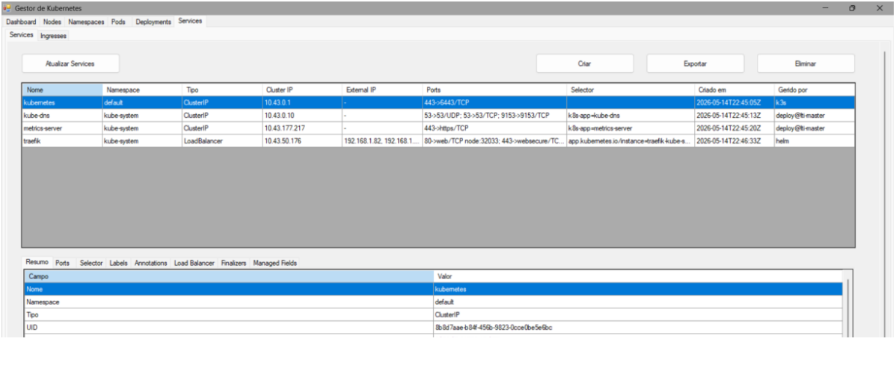
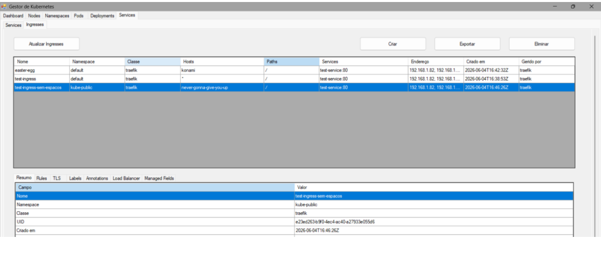
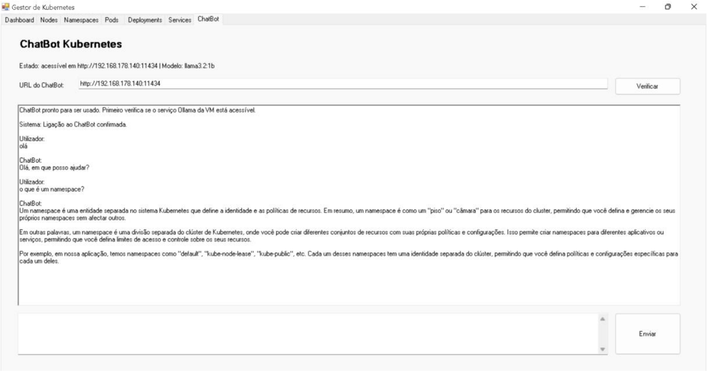

# ☸️ Kubernetes Controller

### Desktop Application for Kubernetes & K3s Cluster Management


---

## 📖 Overview

**Kubernetes Controller** is a desktop application developed in **C# using Windows Forms (.NET)** to simplify the management and administration of **Kubernetes clusters running on K3s**.

The application provides a graphical interface for interacting with Kubernetes resources through the **Kubernetes REST API**, allowing users to inspect cluster information, manage workloads, and export resource configurations without relying exclusively on command-line tools.

It also integrates a **local AI assistant powered by Ollama (Llama 3.2 1B)**, designed to provide contextual explanations about Kubernetes concepts and application functionality.

The project was developed in an academic environment to explore:

- Kubernetes cluster administration and orchestration
- REST API integration and HTTP communication
- Role-Based Access Control (RBAC)
- Desktop application development with C# and .NET
- Local AI integration using Ollama

> **Project scope:** This application is intended for educational purposes and controlled laboratory environments. It is not designed as a production-ready Kubernetes management platform.

---

## 🖥️ Application Preview



*Main dashboard providing an overview of the connected Kubernetes cluster and its resources.*

---

## 📸 Application Screenshots

### 🔌 Cluster Connection

The application provides a graphical interface for connecting to a Kubernetes cluster through its API server.



*Connection interface for configuring access to the Kubernetes cluster.*

### ☸️ Cluster & Resource Management

The application allows users to inspect and manage supported Kubernetes resources through dedicated graphical interfaces.

#### Cluster Nodes & Namespaces

| Nodes | Namespaces |
|:---:|:---:|
|  |  |
| View cluster nodes and their status. | Inspect and manage Kubernetes namespaces. |

#### Pods & Deployments

| Pods | Deployments |
|:---:|:---:|
|  |  |
| Inspect and manage Pods. | Manage application Deployments. |

#### Services & Ingresses

| Services | Ingresses |
|:---:|:---:|
|  |  |
| Inspect and manage Services. | Inspect and manage Ingress resources. |

### 🤖 Local AI Assistant

The application integrates a locally hosted AI assistant powered by **Ollama and Llama 3.2 1B**, designed to answer questions about Kubernetes concepts and supported application features.



*Local AI assistant providing informational guidance about Kubernetes and the application.*

The assistant does not directly execute cluster operations or modify Kubernetes resources.

---

## 🎯 Project Objectives

The main objective of this project is to develop a centralized desktop interface that simplifies common Kubernetes administration tasks while providing practical experience in cluster management and software integration.

The project focuses on:

1. **Centralized Management** — Provide a graphical interface to interact with Kubernetes cluster resources.
2. **Resource Administration** — Perform supported operations on workloads and infrastructure resources.
3. **Cluster Visibility** — Display cluster information, resource states, and available capacity.
4. **Configuration Export** — Retrieve and export Kubernetes resource definitions in YAML and JSON formats.
5. **Secure API Communication** — Authenticate requests using Kubernetes ServiceAccounts and RBAC.
6. **AI-Assisted Learning** — Integrate a local language model to explain Kubernetes concepts and application features.

---

## ✨ Key Features

### 📊 Cluster Overview

- View connected Kubernetes cluster information.
- Inspect cluster nodes and their status.
- Display available CPU and memory capacity information.
- Visualize Kubernetes workload and resource states.
- Navigate between supported resource categories.

### ☸️ Kubernetes Resource Management

Manage supported Kubernetes resources through a graphical interface.

| Resource | Supported Operations |
|---|---|
| **Namespaces** | View, create and delete |
| **Pods** | View, inspect and delete |
| **Deployments** | View, create and delete |
| **Services** | View, create and delete |
| **Ingresses** | View, create and delete |

*Available operations depend on the functionality implemented in the application and the permissions granted to the configured Kubernetes ServiceAccount.*

### 📄 YAML & JSON Export

- Retrieve Kubernetes resource configurations through the REST API.
- Export supported resources to YAML or JSON files.
- Inspect exported definitions for learning, documentation, and configuration analysis.

### 🤖 Local AI Assistant — Ollama

The application integrates an AI assistant using **Ollama** and **Llama 3.2 1B**.

The assistant is designed to:

- Explain Kubernetes and K3s concepts.
- Provide guidance on supported application features.
- Help users understand common resource types and operations.
- Operate using a locally hosted language model.

**Important:** The AI assistant provides informational support only. It does not directly execute Kubernetes operations or modify cluster resources. Generated responses may require verification.

### 🔐 Kubernetes API Authentication

- Communicate with the Kubernetes API server over HTTPS.
- Authenticate requests using bearer tokens.
- Use Kubernetes ServiceAccounts for API access.
- Apply Role-Based Access Control (RBAC) to manage permissions.

> **Security note:** The example configuration included in this repository is intended for a controlled laboratory environment. Production environments should use least-privilege RBAC permissions, secure credential storage, and appropriate network access controls.

---

## 🏗️ System Architecture

The application follows a client-server communication model:

```text
┌─────────────────────────────────────────┐
│          Kubernetes Controller          │
│             C# / WinForms               │
│                                         │
│  Dashboard | Resources | AI Assistant   │
└───────────────────┬─────────────────────┘
                    │
          HTTPS / REST API
                    │
                    ▼
┌─────────────────────────────────────────┐
│              K3s Cluster                │
│            Ubuntu Server VM             │
│                                         │
│  Kubernetes API Server                  │
│  ├── Namespaces                         │
│  ├── Pods                               │
│  ├── Deployments                        │
│  ├── Services                           │
│  └── Ingresses                          │
└─────────────────────────────────────────┘

           Separate AI Integration

┌─────────────────────────────────────────┐
│          Kubernetes Controller          │
│              AI Assistant               │
└───────────────────┬─────────────────────┘
                    │
                  HTTP
                    │
                    ▼
┌─────────────────────────────────────────┐
│                Ollama                   │
│             Llama 3.2 1B                │
│          Locally Hosted Model           │
└─────────────────────────────────────────┘
```

**Architecture Summary:**

- **Desktop Client:** C# Windows Forms application providing the user interface.
- **Kubernetes API:** REST-based communication with the K3s cluster.
- **K3s Environment:** Lightweight Kubernetes cluster hosted on an Ubuntu Server virtual machine.
- **Authentication:** Bearer-token authentication using a Kubernetes ServiceAccount.
- **AI Integration:** Independent HTTP communication with a locally hosted Ollama instance.

---

## 🛠️ Technologies Used

| Category | Technologies |
|---|---|
| **Programming Language** | C# |
| **Desktop Framework** | Windows Forms (.NET) |
| **Container Orchestration** | Kubernetes, K3s |
| **API Communication** | Kubernetes REST API, HTTP/HTTPS |
| **Authentication & Authorization** | Bearer Tokens, Kubernetes ServiceAccounts, RBAC |
| **Data Formats** | JSON, YAML |
| **Artificial Intelligence** | Ollama, Llama 3.2 1B |
| **Server Environment** | Ubuntu Server (Virtual Machine) |
| **Development Environment** | Visual Studio |
| **Client Platform** | Windows |

The Windows Forms application runs on Windows and communicates with a K3s cluster hosted on an Ubuntu Server virtual machine.

The AI assistant communicates independently with an Ollama instance hosted in the same laboratory environment.

---


## 📋 Requirements

### Windows Client

- Windows 10 or Windows 11
- Visual Studio with the .NET Desktop Development workload
- Network connectivity to the Ubuntu Server VM
- Access to the Kubernetes API server
- A valid Kubernetes ServiceAccount token

### Ubuntu Server VM

- Ubuntu Server
- K3s installed and running
- Kubernetes API server accessible from the Windows client
- Appropriate Kubernetes RBAC permissions

### Optional: Local AI Assistant

To use the integrated AI assistant, the Ubuntu Server VM must also have:

- Ollama installed and running
- The `llama3.2:1b` model available
- TCP port `11434` accessible from the Windows client through a trusted network

> **Note:** The Kubernetes management features can operate independently of the Ollama service. Ollama is only required for the local AI assistant.

---

## K3s Access Configuration


> ⚠️ **Security Warning — Laboratory Environment Only**
>
> This configuration assigns the `cluster-admin` ClusterRole to a dedicated ServiceAccount, granting unrestricted access to Kubernetes cluster resources.
>
> **This configuration is intended exclusively for controlled laboratory environments and must not be used in production.**
>
> For production environments:
> - Apply the principle of least privilege using dedicated RBAC permissions.
> - Protect ServiceAccount tokens as sensitive credentials.
> - Never commit authentication tokens or secrets to version control.


The application requires a Kubernetes ServiceAccount and the necessary RBAC permissions.

Create a file named:

```text
kubernetes-controller-access.yaml
```

Add the following configuration:

```yaml
apiVersion: v1
kind: Namespace
metadata:
  name: kubernetes-controller
---
apiVersion: v1
kind: ServiceAccount
metadata:
  name: kubernetes-controller-sa
  namespace: kubernetes-controller
---
apiVersion: rbac.authorization.k8s.io/v1
kind: ClusterRoleBinding
metadata:
  name: kubernetes-controller-admin
subjects:
  - kind: ServiceAccount
    name: kubernetes-controller-sa
    namespace: kubernetes-controller
roleRef:
  kind: ClusterRole
  name: cluster-admin
  apiGroup: rbac.authorization.k8s.io
```

Apply it:

```bash
sudo k3s kubectl apply -f kubernetes-controller-access.yaml
```

Generate a token:

```bash
sudo k3s kubectl create token kubernetes-controller-sa \
  -n kubernetes-controller \
  --duration=8760h
```

Copy the generated token and use it on the application connection screen.

---

### ServiceAccount Token

Generate a token for the configured ServiceAccount:

```bash
sudo k3s kubectl create token kubernetes-controller-sa \
  -n kubernetes-controller \
  --duration=8760h
```

> The requested token duration may be limited by the
> Kubernetes API server configuration. Always verify
> the effective token expiration time.

Copy the generated token and provide it through the
application's connection interface.

Never store the token in source code or commit it to GitHub.


> The `cluster-admin` role is convenient for a controlled educational environment, but it provides unrestricted access to the cluster. A production deployment should use a dedicated least-privilege ClusterRole.

---


## 🤖 Ollama Configuration

The application integrates a locally hosted AI assistant
powered by Ollama and the `llama3.2:1b` model.

Ollama runs on the Ubuntu Server VM and communicates
with the Windows application through HTTP.

### 1. Verify Ollama Installation

```bash
ollama --version
```

List the available models:

```bash
ollama list
```

### 2. Download the Language Model

If the required model is not installed:

```bash
ollama pull llama3.2:1b
```

Test the model locally:

```bash
ollama run llama3.2:1b
```

### 3. Configure Network Access

By default, Ollama normally listens on the local interface.

To make it accessible from the Windows application,
edit the systemd service configuration:

```bash
sudo systemctl edit ollama.service
```

Add the following configuration:

```ini
[Service]
Environment="OLLAMA_HOST=0.0.0.0:11434"
```

Apply the changes:

```bash
sudo systemctl daemon-reload
sudo systemctl restart ollama
```

### 4. Verify the Service

Check the Ollama service status:

```bash
sudo systemctl status ollama --no-pager
```

From the Windows computer, test connectivity:

```bash
curl http://VM_IP:11434
```

Replace `VM_IP` with the IP address of the Ubuntu Server VM.

The expected response is:

```text
Ollama is running
```

### Security Considerations


> ⚠️ **Security Warning — Ollama Network Exposure**
>
> Binding Ollama to `0.0.0.0` makes its API accessible through all available network interfaces.
>
> **Only enable this configuration within a trusted laboratory network.**
>
> Ensure that:
> - Access is restricted through appropriate firewall rules.
> - The API is not exposed directly to the public Internet.
> - Only authorized devices can connect to the Ollama service.


The chatbot is optional. If Ollama is unavailable, the
Kubernetes management features remain accessible.


---

## Running the Application

1. Start the Ubuntu VM.
2. Confirm that K3s is running:

   ```bash
   sudo systemctl status k3s --no-pager
   ```

3. Confirm that Ollama is running:

   ```bash
   sudo systemctl status ollama --no-pager
   ```

4. Open the solution in Visual Studio.
5. Build the project.
6. Start the application.
7. Enter the Ubuntu VM IP address.
8. Paste the Kubernetes ServiceAccount token.
9. Connect to the cluster.

The application normally builds the Kubernetes API URL as:

```text
https://VM_IP:6443
```

When no token is provided, the application may use a `kubectl proxy` connection such as:

```text
http://VM_IP:8001
```

---


## 🔗 Kubernetes API Endpoints

The application communicates directly with the
Kubernetes API server through REST requests.

### Cluster-Wide Endpoints

| Resource | HTTP Method | API Endpoint |
|---|---|---|
| Cluster Version | GET | `/version` |
| Nodes | GET | `/api/v1/nodes` |
| Namespaces | GET | `/api/v1/namespaces` |
| Pods | GET | `/api/v1/pods` |
| Deployments | GET | `/apis/apps/v1/deployments` |
| Services | GET | `/api/v1/services` |
| Ingresses | GET | `/apis/networking.k8s.io/v1/ingresses` |

### Namespaced Resource Endpoints

| Resource | API Endpoint |
|---|---|
| Pods | `/api/v1/namespaces/{namespace}/pods` |
| Deployments | `/apis/apps/v1/namespaces/{namespace}/deployments` |
| Services | `/api/v1/namespaces/{namespace}/services` |
| Ingresses | `/apis/networking.k8s.io/v1/namespaces/{namespace}/ingresses` |

The application also uses the corresponding
resource-specific API endpoints for supported
creation, inspection, and deletion operations.

All authenticated requests are subject to the
permissions assigned to the Kubernetes ServiceAccount.


---


## 📂 Repository Structure

```text
Kubernetes-Controller/
│
├── KubernetesController/
│   └── Application source code and project files
│
├── docs/
│   └── images/
│       ├── chatbot.png
│       ├── connection.png
│       ├── dashboard.png
│       ├── deployments.png
│       ├── ingresses.png
│       ├── namespaces.png
│       ├── nodes.png
│       ├── pods.png
│       └── services.png
│
├── LICENSE
└── README.md
```

The `KubernetesController` directory contains the
Windows Forms application source code and related
project files.

The `docs/images` directory contains screenshots
demonstrating the application's interface and features.

The repository also includes documentation for configuring
Kubernetes ServiceAccount access and the Ollama integration.


---

## Security Notes

Do not commit the following information to GitHub:

- Kubernetes bearer tokens;
- ServiceAccount tokens;
- credentials;
- kubeconfig files containing certificates or tokens;
- exported resources containing secrets.

Recommended `.gitignore` entries:

```gitignore
.vs/
bin/
obj/
*.user
*.suo
*.cache
*.log
appsettings.local.json
secrets.json
token.txt
kubeconfig
```

If a token is accidentally exposed, generate a new one and stop using the previous token.

---

## Known Limitations

- The application is intended primarily for educational and controlled laboratory environments.
- The current chatbot uses a small 1B parameter model, so complex answers may be limited.
- Chatbot availability depends on the Ubuntu VM and the Ollama service.
- The chatbot is informational and does not execute cluster operations.
- XML export is not supported.
- The current RBAC example uses `cluster-admin`.
- Advanced resources such as ConfigMaps, Secrets, StatefulSets, DaemonSets, Jobs, CronJobs, and persistent volumes are not yet managed by the interface.

---

## Possible Future Improvements

- least-privilege Kubernetes RBAC;
- support for ConfigMaps and Secrets;
- support for StatefulSets, DaemonSets, Jobs, and CronJobs;
- pod log visualization;
- Kubernetes event visualization;
- resource editing;
- YAML import and deployment;
- filtering and searching;
- namespace-specific views;
- configurable Ollama model and endpoint;
- chatbot conversation history;
- more detailed cluster health diagnostics;
- secure configuration storage;
- automated tests;
- installer or release package.

---

## Educational Purpose

This project demonstrates practical knowledge in:

- Kubernetes resource management;
- K3s administration;
- Kubernetes REST API usage;
- authentication and RBAC;
- asynchronous HTTP communication in C#;
- JSON and YAML processing;
- WinForms interface development;
- local AI model integration;
- virtual machine networking;
- software documentation.

---


## 📄 License

This project is licensed under the MIT License.

See the [LICENSE](LICENSE) file for details.

---

## 👨‍💻 Author

**José Branco**

Computer Science Engineering Student

GitHub: [josebranco13](https://github.com/josebranco13)

Developed as an academic and portfolio project focused on
Kubernetes cluster administration, K3s, REST API integration,
C# desktop development, and local AI assistance.
